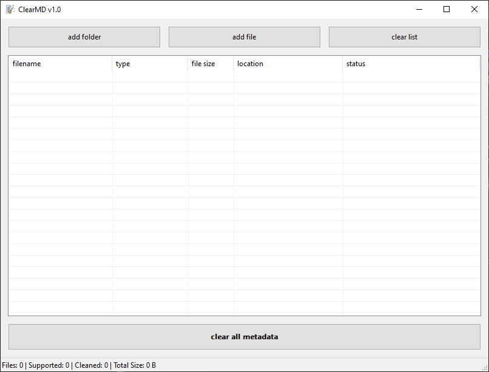

# ClearMD v1.0

**Lossless metadata stripper for Windows.** Add files or folders, click one button, and ClearMD removes the
hidden personal data inside them (author names, GPS locations, camera info, edit history, thumbnails, tags, cover art)
**without re-encoding or touching the actual content**: photos keep their exact pixels, audio and video their exact samples,
documents their exact text.

Single portable `ClearMD.exe`. No installer, no runtime, no dependencies (native C++17 / Win32, statically linked).
On every launch it checks GitHub for a newer release; that check is the only network access (no account, no telemetry).



---

## Quick start

1. Run `ClearMD.exe` (Windows 10 / 11, 64-bit).
2. Add files: **add file**, **add folder** (scans sub-folders), or drag and drop files and folders onto the window.
3. Click **clear all metadata**.
4. Read the warning, click **Proceed**, and wait for the 3-second progress bar. **Cancel** works at any moment before it fills.
5. Check the **status** column for the result of each file.

> **There is no automatic backup, and deleted metadata cannot be recovered.** Work on copies if the originals matter.

---

## What gets removed

Metadata is defined by each file format, so ClearMD understands the formats below. For **any other file** it still removes
the file-system metadata it can (see [streams](#reading-the-status-column)).

| Kind | Extensions | Removed | Kept |
|---|---|---|---|
| **Photos** | jpg, jpeg, jpe, jfif, png, webp, gif | Exif, XMP, IPTC / Photoshop blocks, GPS, camera and software info, comments, text chunks, timestamps, C2PA content credentials, GIF comment and application blocks | Pixels, colour profile (ICC), animation |
| **HEIC / AVIF** | heic, heif, hif, avif | Exif and XMP items | Image data, rotation |
| **Vector** | svg | `<metadata>`, comments, Inkscape / Sodipodi editor data (including local export paths) | Drawing, `<title>`, `<desc>` |
| **PDF** | pdf | Title, author, subject, keywords, creator, producer, dates, XMP | All pages and content |
| **Office** | docx, docm, dotx, dotm, xlsx, xlsm, xltx, xltm, pptx, pptm, potx, potm, ppsx, ppsm | Author, last-modified-by, company, manager, dates, template, statistics, custom properties, preview thumbnail | Document content and styles |
| **OpenDocument** | odt, ods, odp, odg, ott, ots, otp | Creator, dates, generator, user-defined fields, preview thumbnail | Document content |
| **Audio** | mp3, flac, wav, aif, aiff, aifc | ID3v1 / ID3v2 / APE tags, Vorbis comments, cover art, LIST-INFO, bext, iXML, XMP, name / author / annotation chunks | Audio data |
| **Video / audio containers** | mp4, m4a, m4b, m4v, mov, 3gp, 3g2 | Tags, GPS, cover art, XMP, creation / modification times | Video and audio streams |
| | mkv, mka, mk3d, webm | Tags, title, date, file names, track names | Video and audio streams |
| | avi | INFO tags, date, stream names, junk payloads | Video and audio streams |
| **Everything else** | any extension | NTFS alternate data streams (e.g. the "downloaded from the Internet" mark) | The file itself |

---

## Reading the status column

| Status | Meaning |
|---|---|
| **Ready** | ClearMD knows this format and will clean it. |
| **Ready (streams only)** | ClearMD does **not** know how to look inside this file type (for example `.txt`, `.zip`, `.exe`), so the only thing it can do is remove **NTFS alternate data streams**. These are hidden extra data blocks that Windows attaches to a file outside its normal content. The best-known one is `Zone.Identifier`, which records that a file was downloaded and from where. The file's own content is never changed. |
| **Cleaned** / **Cleaned (-12.3 KB)** | Metadata was removed. The number is how much smaller the file became (in-place formats such as MP4, MKV, AVI and HEIC keep their exact size). |
| **… + 1 NTFS stream** | An alternate data stream was removed as well. |
| **Clean (no metadata found)** | Nothing to remove. The file was not modified. |
| **Nothing to remove** | Unknown format and no alternate streams found. |
| **Failed: …** | The file was left untouched. The reason is shown (not a valid file, read-only or in use, encrypted, too large, disk full, and so on). |

---

## Keyboard and mouse

| Action | How |
|---|---|
| Remove selected rows from the list | **Delete** key, or right-click, **Remove from list** |
| Select all rows | **Ctrl+A**, or right-click, **Select all** |
| Add by drag and drop | Drop files or folders anywhere on the window |

Removing a row only removes it from the list. **Files on disk are never deleted.**

---

## Update check

ClearMD asks GitHub for the latest published release once at every launch. If that release is newer than the running
build, a dialog offers to open its release page in the browser; nothing is downloaded or installed automatically.

- It is the **only** network access ClearMD makes. No account, no identifier, no telemetry is sent.
- Offline, rate-limited or blocked: the check fails silently and the app works exactly as usual.
- The comparison uses the release tag (`v1.0.0.6`, `v1.1` ...) against the build's file version; missing parts count as zero.
  Publish releases tagged with the build's full file version (`v1.0.0.7`): a bare `v1.0` counts as `1.0.0.0` and is not offered to a `1.0.0.x` build.
- The check runs on a background thread and never delays startup.

---

## Safety notes

- **No backup, no undo.** Cleaning modifies your files in place.
- **Warning and countdown.** Nothing is touched until you click **Proceed** *and* the 3-second progress bar completes.
- **Safe writes.** Files that need rewriting are written to a temporary file (`*.clearmd_tmp`) first and swapped in only if the write succeeded. A truncated or invalid file is rejected and left untouched.
- **Dry run first.** Formats patched in place (MP4, MKV, AVI, HEIC) are validated completely before a single byte is changed.
- **Digital signatures break.** Changing a signed PDF or Office document invalidates its signature.
- **Photo rotation.** A JPEG's rotation flag lives in its Exif block. Removing Exif can make a rotated phone photo display sideways, because fixing it would require re-encoding. (HEIC rotation is stored separately and is kept.)
- **Mark of the Web.** Removing `Zone.Identifier` also removes Windows' "this file came from the Internet" mark, so SmartScreen will no longer warn about it.
- **Modified time.** A file's modified date changes when ClearMD changes the file. Files that were already clean are not touched.

---

## Limitations

- Metadata is format-specific, so "any file" means: every supported format above, plus file-system streams for the rest.
- Not supported: TIFF, OGG / Opus, RAW camera files, SVGZ, encrypted or password-protected files, ZIP64 packages.
- Author names written *inside* Word comments or tracked changes are not removed (only the document properties are).
- PDFs that keep their info dictionary inside compressed object streams are reported as unsupported and left untouched.
- Formats that must be rewritten (images, documents, MP3, FLAC, WAV, AIFF, GIF, SVG) are skipped above **1.5 GB**. In-place formats (MP4, MKV, AVI, HEIC) have no size limit.
- Windows only (NTFS stream removal needs NTFS; on other file systems that step does nothing).

---

## Building from source

Source lives in [`cpp/`](cpp/). It needs only a C++17 compiler and the Windows SDK headers.

**MinGW-w64 (GCC)**, from the `cpp` folder:
```cmd
build_mingw.bat
```
**MSVC**, from an "x64 Native Tools Command Prompt for VS":
```cmd
build_msvc.bat
```
**CMake:**
```cmd
mkdir build && cd build
cmake ..
cmake --build . --config Release
```
The result is a single `ClearMD.exe` with the icon, manifest and version info embedded.
The release build was produced and tested with MinGW-w64 GCC 13 (`-Wall -Wextra`, zero warnings); the MSVC and CMake scripts are provided but were not run for this release.

### Project layout

```
cpp/
  ClearMD.cpp          the whole application (format handlers + Win32 UI)
  ClearMD.rc           resources: icon, version info, manifest
  resource.h           ids, app title, version numbers
  ClearMD.ico          app icon (7 sizes)   make_icon.py regenerates it
  manifest.xml         DPI awareness, Windows 10 compatibility, long paths
  build_mingw.bat  build_msvc.bat  CMakeLists.txt
src/                   React demo (see below)
tools/                 test suite, Wine smoke test, version bump, viewer sync (see AGENTS.md)
```

---

## Web demo

`src/` contains a small React simulator of the app's window plus a viewer for the C++ source. It is a demo only; the real tool is the `.exe`.
It needs no API key.

```cmd
npm install
npm run dev
```

---

See [RELEASE_NOTES.md](RELEASE_NOTES.md) for what changed, and [AGENTS.md](AGENTS.md) if you want to work on the code (architecture, tests, how to add a format).
